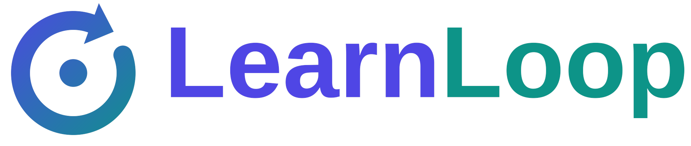

<p align="center"></p>

# LearnLoop

LearnLoop is an AI learning companion that runs on your own computer. You chat with it about any
subject, attach your notes and textbooks as knowledge bases, and it can solve problems step by
step, write practice questions, research a topic, draw diagrams and animations, and guide you
through a topic until you have mastered it. It remembers what you have studied across sessions.

LearnLoop is built on the open-source [DeepTutor](https://github.com/HKUDS/DeepTutor) project by
the Data Intelligence Lab, The University of Hong Kong (Apache-2.0). [NOTICE](NOTICE) lists what
this version changes. A technical report describing the system is in [docs/](docs/).

## Features

| Mode | What it does |
| --- | --- |
| Chat | Agentic chat that explores with tools, then answers |
| Ask questions | Asks you clarifying questions first, then completes the request |
| Deep solve | Multi-step problem solving |
| Deep question | Generates practice questions in batches |
| Deep research | Breaks a topic into subtopics, researches each, and writes a report |
| Visualize | Builds a validated chart, diagram (SVG, Chart.js, Mermaid, HTML) or Manim animation |
| Math animator | Turns a math concept into a Manim animation or storyboard |
| Video lesson | Writes an animated video lesson with narration that plays in the browser |
| Guided learning | Mastery-based tutoring: an adaptive path that tracks what you have mastered |
| Immersive reading | Reads a document or video with you and cites the exact page or timestamp |
| Audio overview | Creates a two-voice audio summary of a knowledge base |

Tools you can switch on: web search, arXiv paper search, Zotero search, deep reasoning, brainstorming,
GeoGebra image analysis, image generation and video generation. Knowledge bases, memory and
notebooks are added automatically when you use them.

## Requirements

- Windows 10/11, macOS or Linux
- Python 3.11 to 3.14 (3.12 recommended)
- Node.js 22 LTS or newer
- A model to talk to: an API key from a provider such as OpenAI, Anthropic, Gemini, DeepSeek or
  OpenRouter, or a local model server (Ollama, LM Studio, llama.cpp, vLLM) for fully offline use

## Run on Windows

1. Install [Python 3.12](https://www.python.org/downloads/) (tick **Add python.exe to PATH**) and
   [Node.js 22 LTS](https://nodejs.org/).
2. Put the project in a short path such as `C:\LearnLoop`. Long paths can break `npm` on Windows.
3. Double-click **`setup.bat`**. This runs once and can take 10 to 20 minutes.
4. Double-click **`start.bat`**. The first start builds the web app, which takes a few minutes.
   Then your browser opens http://localhost:3782.
5. Open **Settings**, add your model provider and API key, and start chatting.

To stop LearnLoop, press `Ctrl+C` in the start window.

## Run on macOS or Linux

```bash
python3.12 -m venv .venv
.venv/bin/python -m pip install -r requirements/full.txt
.venv/bin/python -m pip install -e . --no-deps
(cd web && npm ci --legacy-peer-deps)
.venv/bin/learnloop start
```

## Command line

```bash
learnloop start                       # web app (backend + frontend)
learnloop chat                        # chat in the terminal
learnloop run deep_solve "Solve x^2 = 4"
learnloop kb create my-notes --doc notes.pdf
learnloop doctor                      # check that everything is ready
learnloop --help
```

`deeptutor` is the same command under its original name.

## Your data

Everything LearnLoop stores is in `data/`: settings (including API keys), chat history, knowledge
bases and memory. Back it up if it matters to you, and never share it.

The server listens on all network interfaces. On shared networks such as college Wi-Fi, choose
**Cancel** when Windows Firewall asks to allow Python or Node.js on public networks, so only your own
computer can open the app.

## Project layout

| Path | Contents |
| --- | --- |
| `deeptutor/` | Backend: FastAPI server, agents, capabilities, tools, RAG, memory |
| `deeptutor_cli/` | Command-line interface |
| `web/` | Next.js frontend |
| `packages/chat-engine/` | Experimental TypeScript chat engine |
| `tests/` | Test suite |
| `docs/` | Technical report (PDF) and its source |

## Tests

```bash
.venv/bin/python -m pip install pytest pytest-asyncio
.venv/bin/python -m pytest tests deeptutor/learning/tests
cd web && npm run test:unit
```

## License

Apache-2.0. See [LICENSE](LICENSE) and [NOTICE](NOTICE). Third-party notices are in
[THIRD_PARTY_NOTICES.md](THIRD_PARTY_NOTICES.md).
